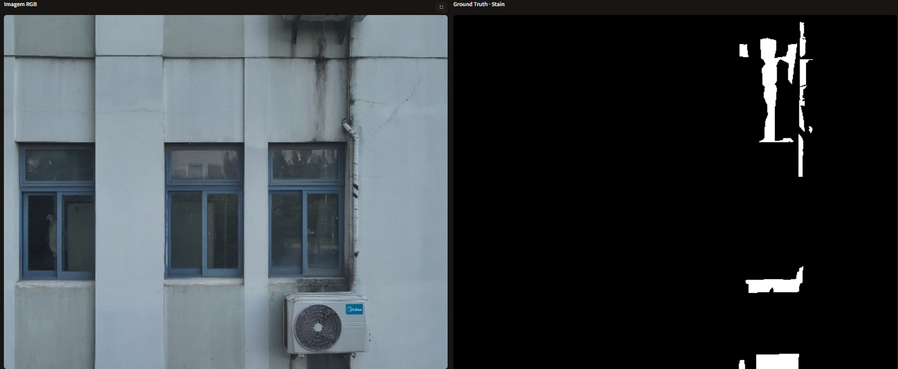
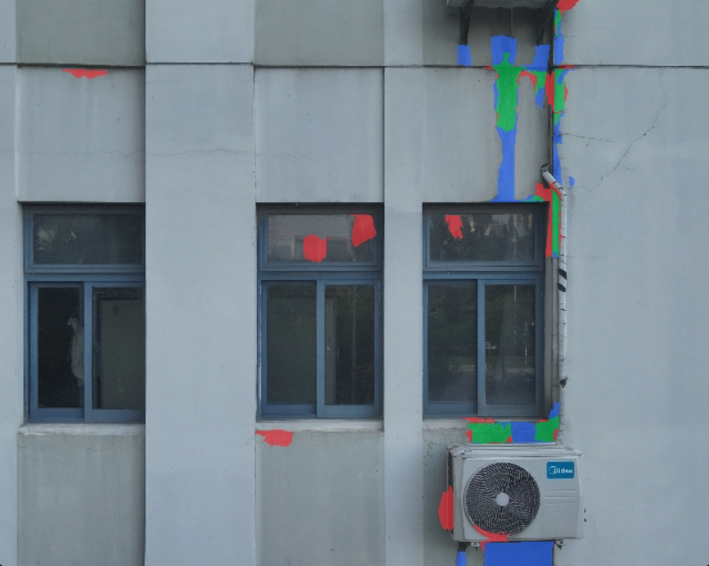
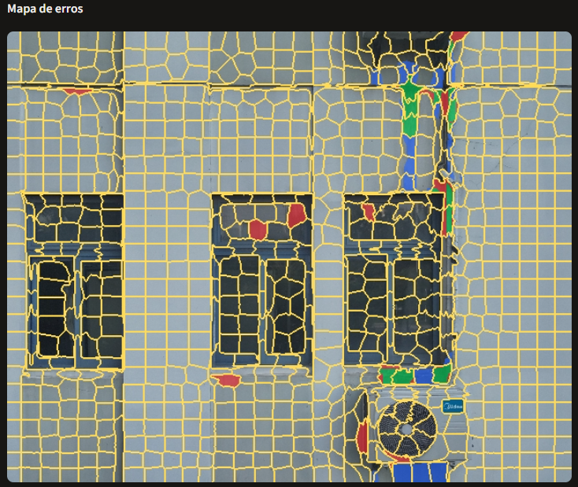
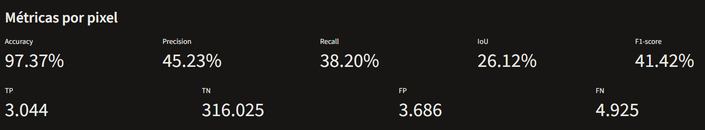
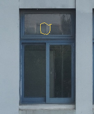
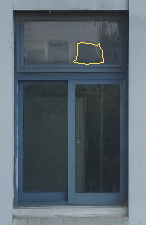
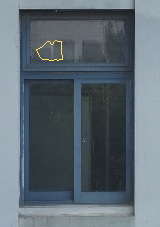
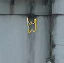
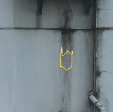
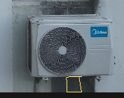

# I01 — Análise qualitativa da baseline de Stain

| Identificação | Informação |
|---|---|
| Registro | I01 |
| Data da investigação | 25/11/2026 |
| Dataset | Beijing Facade Defect Dataset (BFDD) |
| Classe-alvo | Stain (ID original 5; classe binária 1) |
| Abordagem | SLIC + 15 descritores por região + Random Forest |
| Conjunto | Validação |
| Estado | Investigação exploratória registrada; hipóteses pendentes de validação quantitativa |

## 1. Objetivo

Investigar qualitativamente os acertos e erros da baseline de segmentação binária de manchas em fachadas. Busca-se distinguir limitações da discretização em superpixels, erros de classificação, dificuldades de representação de cor, textura e contexto espacial, bem como possíveis divergências entre a interpretação visual e a anotação de referência.

Esta investigação complementa a avaliação quantitativa por pixel. Não constitui uma avaliação independente de generalização, nem altera o conjunto de referência ou o modelo treinado.

## 2. Configuração experimental

O pipeline utiliza imagens RGB, segmentação SLIC, extração de um vetor de 15 características por superpixel e classificação binária com Random Forest. A máscara prevista é reconstruída atribuindo a classe da região a todos os seus pixels. A anotação original do BFDD é convertida em máscara binária de Stain para avaliação.

A baseline utiliza limiar de decisão nominal de 0,50. Segundo os registros anteriores do projeto, o critério de rotulagem do treino considera regiões com ocupação de Stain de até 10% como negativas e de pelo menos 70% como positivas; as intermediárias são ambíguas e excluídas do treino. Na inferência, todas as regiões são classificadas. O rótulo de treino exibido na interface aplica esse critério à região inspecionada; não indica que a região de validação tenha participado do treinamento.

A investigação foi conduzida com a interface gráfica de diagnóstico, utilizando o mapa de erros, as fronteiras SLIC e a inspeção individual de regiões. Os valores das características foram exportados pela interface e preservados nos CSVs anexos.

**Rastreabilidade:** o ID da imagem no manifesto, o hash do commit, a identificação exata do artefato do modelo e os parâmetros completos do SLIC e do Random Forest não foram fornecidos nas evidências desta investigação. Devem ser vinculados à baseline no repositório antes de uma reprodução integral. Não se presume um nome de arquivo ou uma configuração numérica não confirmada.

## 3. Imagem selecionada

A imagem apresenta uma fachada clara com três conjuntos de janelas, tubulação e um aparelho de ar-condicionado. Há alterações escuras na superfície superior direita, próximas à tubulação e ao peitoril, e abaixo do aparelho. As janelas apresentam reflexos e variações de intensidade que dificultam a distinção entre manchas e outros elementos da cena.

*Figura 1 — Captura da interface: imagem RGB à esquerda e anotação binária dos autores à direita. Branco representa Stain.*

*Figura 2 — Sobreposição dos erros: verde = TP; vermelho = FP; azul = FN. Pixels verdadeiros negativos não estão destacados.*

*Figura 3 — Mapa de erros com contornos amarelos dos superpixels.*

## 4. Resultados quantitativos

A baseline global foi avaliada em 132 imagens de validação (75 com Stain e 57 sem Stain), totalizando 43.253.760 pixels, sem erros de processamento. Os dados globais abaixo são os relatados na execução da validação; os valores individuais foram transcritos da interface. As métricas percentuais foram conferidas por meio das contagens de confusão informadas.

| Métrica | Baseline global | Imagem I01 | Diferença (p.p.) |
|---|---:|---:|---:|
| Accuracy | 93,24% | 97,37% | +4,13 |
| Precision | 22,46% | 45,23% | +22,77 |
| Recall | 54,12% | 38,20% | −15,92 |
| IoU | 18,87% | 26,12% | +7,25 |
| F1-score | 31,74% | 41,42% | +9,68 |

| Contagem | Baseline global | Imagem I01 |
|---|---:|---:|
| TP | 679.462 | 3.044 |
| TN | 39.652.337 | 316.025 |
| FP | 2.345.849 | 3.686 |
| FN | 576.112 | 4.925 |
| Total | 43.253.760 | 327.680 |

*Figura 4 — Métricas da imagem selecionada.*

A referência contém 7.969 pixels de Stain (2,43% da imagem), dos quais 4.925 (61,80%) não foram detectados. A previsão contém 6.730 pixels positivos, dos quais 3.686 (54,77%) são falsos positivos. A área positiva prevista é 15,55% menor que a área anotada, mas há considerável deslocamento espacial entre previsão e referência. Globalmente ocorre o oposto: a área prevista é aproximadamente 2,41 vezes a área anotada.

A elevada accuracy é influenciada pela predominância de pixels negativos: prever toda a imagem como não mancha resultaria em 97,57% de accuracy, sem identificar Stain. Por isso, IoU, F1, Precision e Recall são mais informativos para a classe-alvo. A comparação com o resultado global é descritiva: a imagem integra o conjunto de validação, e os valores globais são agregados por pixel, não médias das métricas individuais.

## 5. Análise visual da segmentação

### 5.1. Falsos positivos nas janelas

Observam-se regiões vermelhas no vidro, principalmente onde há reflexos de outros edifícios. Os reflexos produzem alterações de intensidade e textura que podem se assemelhar a manchas no espaço de características. Os contornos SLIC permitem observar que alguns erros coincidem com regiões inteiras. O caso #352 confirma um erro de classificação de uma região inteiramente negativa segundo a referência.

### 5.2. Detecção parcial da mancha superior

A mancha próxima à tubulação apresenta áreas verdes e azuis em sequência. O modelo reconhece partes da alteração, mas não sua extensão completa. Os superpixels #127 e #158 mostram que a abordagem pode reconhecer regiões com alta ocupação de Stain. Ainda não foi inspecionado individualmente um falso negativo dessa mancha superior, portanto a causa da descontinuidade permanece aberta.

### 5.3. Falsos positivos próximos às extremidades das janelas e no ar-condicionado

Alguns erros próximos aos peitoris apresentam alterações visuais que tornam a previsão compreensível. A extensão da área vermelha pode decorrer da classificação de uma região inteira, inclusive quando a alteração visível ocupa apenas parte dela. O aparelho também apresenta falsos positivos em suas bordas. A representação atual não contém informação explícita sobre a identidade semântica de janelas, paredes ou aparelhos.

Atribuir esses erros exclusivamente ao SLIC, à classificação ou às anotações exige inspecionar a ocupação real e a previsão de cada região. Os casos próximos aos peitoris e ao aparelho não foram quantificados individualmente nesta investigação.

### 5.4. Mancha inferior não identificada

A área escura abaixo do aparelho aparece claramente na anotação de Stain, mas grande parte não foi prevista. O superpixel central #764 é um caso de falso negativo com alta ocupação real e escore muito baixo para Stain. Visualmente, a região parece mais homogênea que as manchas superiores. Ela está espacialmente distante dos demais superpixels inspecionados e pertence a outra região de mancha.

### 5.5. Possíveis ambiguidades nas anotações

Há áreas próximas às janelas nas quais alterações visuais podem ser interpretadas como manchas, embora não estejam marcadas como Stain pelos autores. Isso pode refletir ambiguidades na delimitação, critérios de anotação ou diferenças de interpretação. A investigação não comprova erro de anotação nem inconsistência sistemática do BFDD. Os falsos positivos continuam sendo contabilizados conforme a referência original; nenhuma máscara foi alterada.

## 6. Inspeção individual dos superpixels

Seis regiões foram selecionadas intencionalmente, por representarem acertos e erros visualmente relevantes. Os resultados TP, TN, FP e FN na última coluna indicam o comportamento predominante ou o rótulo da região em relação à classificação; não implicam que todos os seus pixels tenham essa mesma categoria.

| ID | Localização | Área (px) | Escore Stain | Ocupação real | Previsão | Rótulo de treino | Resultado |
|---|---|---:|---:|---:|---|---|---|
| #353 | Janela, esquerda | 416 | 1,70% | 0,00% | Não mancha | Não mancha | TN |
| #352 | Reflexo na janela | 431 | 59,39% | 0,00% | Mancha | Não mancha | FP |
| #356 | Janela, direita | 543 | 27,53% | 0,00% | Não mancha | Não mancha | TN |
| #127 | Mancha superior | 326 | 94,44% | 97,55% | Mancha | Mancha | TP |
| #158 | Mancha superior | 398 | 92,19% | 96,73% | Mancha | Mancha | TP |
| #764 | Centro da mancha inferior | 466 | 3,58% | 93,56% | Não mancha | Mancha | FN |

| ID | TP | TN | FP | FN |
|---|---:|---:|---:|---:|
| #353 | 0 | 416 | 0 | 0 |
| #352 | 0 | 0 | 431 | 0 |
| #356 | 0 | 543 | 0 | 0 |
| #127 | 318 | 0 | 8 | 0 |
| #158 | 385 | 0 | 13 | 0 |
| #764 | 0 | 30 | 0 | 436 |

O escore exibido como probabilidade pela interface é a estimativa do Random Forest; sua calibração não foi demonstrada. A ocupação real é calculada a partir da anotação e utilizada exclusivamente para diagnóstico e avaliação, não como feature de inferência.

### 6.1. #352 — Reflexo incorretamente classificado

O reflexo tem ocupação nula de Stain e escore de 59,39%, gerando 431 FP. É um erro de classificação em relação à referência, não uma consequência inevitável de mistura de pixels positivos e negativos. O escore é relativamente próximo do limiar: um valor de 0,60 rejeitaria essa região, sem que isso demonstre melhoria global.

[Evidência da interface](assets/I01/sp_352_indicadores.png) · [CSV original](assets/I01/sp_352_features.csv)

### 6.2. #356 — Vidro à direita

Região negativa com escore de 27,53%. É mais escura que #352 em luminosidade média, mas possui menor contraste GLCM e menor entropia. A comparação indica que luminosidade baixa, isoladamente, não explica a decisão.

[Evidência da interface](assets/I01/sp_356_indicadores.png) · [CSV original](assets/I01/sp_356_features.csv)

### 6.3. #353 — Vidro à esquerda

Região negativa com escore de 1,70%. Sua luminosidade média e o canal a* são praticamente iguais aos de #352, embora os escores difiram em 57,69 pontos percentuais. O contraste GLCM é menor e a homogeneidade maior. A comparação é especialmente relevante por envolver regiões próximas da mesma janela.

[Evidência da interface](assets/I01/sp_353_indicadores.png) · [CSV original](assets/I01/sp_353_features.csv)

### 6.4. #127 — Mancha superior corretamente identificada

Com 97,55% de ocupação real e escore de 94,44%, apresenta elevada correspondência com a referência. Possui o maior contraste GLCM, maior desvio padrão de luminosidade, maior entropia e maior gradiente médio entre as seis regiões analisadas.

[Evidência da interface](assets/I01/sp_127_indicadores.png) · [CSV original](assets/I01/sp_127_features.csv)

### 6.5. #158 — Mancha superior corretamente identificada

Com 96,73% de ocupação e escore de 92,19%, é um segundo caso de sucesso na mancha superior. Apresenta textura menos contrastada que #127, mas mantém escore elevado. Seus valores de contraste e ASM da GLCM são próximos dos de #352, o reflexo classificado incorretamente.

[Evidência da interface](assets/I01/sp_158_indicadores.png) · [CSV original](assets/I01/sp_158_features.csv)

### 6.6. #764 — Mancha inferior não identificada

Região central da mancha abaixo do ar-condicionado, selecionada por apresentar escore particularmente baixo (3,58%), apesar de 93,56% de ocupação anotada. A previsão negativa resulta em 436 FN. A região apresenta a menor luminosidade média, menor contraste GLCM, menor entropia e menor gradiente médio entre as seis regiões.

O erro não é próximo do limiar nem inevitável pela geometria do superpixel: uma previsão positiva recuperaria 436 pixels de Stain, ao custo de 30 FP. Isso não constitui uma proposta de correção manual da máscara, apenas um diagnóstico do potencial de classificação dessa região.

**Observação espacial:** #764 não é vizinho dos superpixels da janela nem de #127 ou #158. Os superpixels imediatamente adjacentes a #764 ainda não foram inspecionados. Não é possível estabelecer uma comparação centro–fronteira dessa mancha com os dados disponíveis.

[Evidência da interface](assets/I01/sp_764_indicadores.png) · [CSV original](assets/I01/sp_764_features.csv)

## 7. Comparação das características

Os valores abaixo foram extraídos diretamente dos seis CSVs anexos, arredondados para quatro casas decimais. Os arquivos originais preservam a precisão da exportação.

| Feature | #353 (TN) | #352 (FP) | #356 (TN) | #127 (TP) | #158 (TP) | #764 (FN) |
|---|---:|---:|---:|---:|---:|---:|
| `mean_l` | 39,6795 | 39,5455 | 32,9268 | 39,0460 | 49,3750 | 20,6694 |
| `mean_a` | -2,0075 | -2,0074 | -1,3778 | -2,2787 | -2,3353 | -1,7148 |
| `mean_b` | -4,2313 | -4,7757 | -4,8709 | -1,8780 | -3,5631 | -3,2524 |
| `std_l` | 3,7841 | 4,1820 | 2,9089 | 5,0742 | 3,5324 | 1,9820 |
| `std_a` | 1,0389 | 0,7733 | 0,6879 | 0,5761 | 0,6169 | 0,7769 |
| `std_b` | 1,2504 | 0,7910 | 1,2054 | 0,7779 | 0,6872 | 0,6307 |
| `delta_l` | 2,2087 | 2,1091 | -3,8238 | -5,0118 | -3,1781 | -9,5919 |
| `delta_a` | -0,2714 | -0,1276 | 0,2979 | 0,1340 | 0,4105 | -0,1749 |
| `delta_b` | 1,2798 | 1,1120 | 1,9165 | 0,8285 | -0,1790 | 0,7368 |
| `hist_entropy` | 2,2146 | 2,4757 | 1,9126 | 2,7387 | 2,2529 | 1,5766 |
| `glcm_contrast` | 0,8043 | 1,2285 | 0,8580 | 2,5595 | 1,2831 | 0,4966 |
| `glcm_homogeneity` | 0,7570 | 0,6982 | 0,7531 | 0,5424 | 0,6450 | 0,7856 |
| `glcm_asm` | 0,1523 | 0,0736 | 0,1799 | 0,0425 | 0,0744 | 0,1774 |
| `glcm_correlation` | 0,7354 | 0,6812 | 0,5321 | 0,4850 | 0,5095 | 0,5205 |
| `mean_gradient` | 0,1303 | 0,1539 | 0,1159 | 0,2705 | 0,1765 | 0,1049 |

### 7.1. Similaridade cromática e diferenças texturais na janela

#353 e #352 possuem `mean_l` de 39,6795 e 39,5455, respectivamente, e valores quase idênticos de `mean_a`. Entretanto, #352 apresenta contraste GLCM maior (1,2285 contra 0,8043), homogeneidade menor (0,6982 contra 0,7570), ASM menor e gradiente médio maior. Considerando os três superpixels da janela ordenados por escore (#353, #356, #352), o contraste GLCM aumenta e a homogeneidade diminui.

Esse comportamento é compatível com a hipótese de confusão entre irregularidades de reflexos e manchas. Não demonstra que essas características causaram a decisão do Random Forest.

### 7.2. Similaridades entre reflexos e manchas reais

Os superpixels #352 (FP) e #158 (TP) possuem valores próximos de contraste GLCM (1,2285 e 1,2831) e ASM (0,0736 e 0,0744). O reflexo inclusive apresenta entropia e desvio padrão de luminosidade maiores que #158. Essas semelhanças sugerem sobreposição parcial das representações de elementos visualmente distintos. O fato de #158 manter escore elevado com contraste aproximadamente metade do de #127 mostra que irregularidade textural elevada não é condição necessária para a decisão positiva nesses casos.

### 7.3. Uniformidade da mancha inferior

#764 apresenta contraste GLCM de 0,4966, homogeneidade de 0,7856, entropia de 1,5766 e gradiente médio de 0,1049. Esses valores são coerentes com a percepção de uma região mais uniforme. A comparação sugere investigar se manchas homogêneas são sub-representadas ou pouco discriminadas pelas features e pelo modelo. Trata-se de um exemplo selecionado, não de uma tendência já demonstrada no dataset.

### 7.4. Contexto espacial e correção da interpretação de vizinhança

| Superpixel | `mean_l` | `delta_l` | Escore Stain |
|---|---:|---:|---:|
| #127 | 39,0460 | −5,0118 | 94,44% |
| #158 | 49,3750 | −3,1781 | 92,19% |
| #764 | 20,6694 | −9,5919 | 3,58% |

Cada `delta_l` se refere ao contexto próprio do superpixel, e não a diferenças entre as seis regiões selecionadas. Caso a implementação corresponda à média da região menos a média de sua vizinhança, o sinal negativo indica uma região mais escura que seu entorno imediato. Essa definição exata deve ser confirmada no código antes de atribuir significado físico à magnitude.

#764 possui o maior valor absoluto de `delta_l` entre as regiões analisadas. Logo, os dados não sustentam a explicação simples de que seu escore baixo decorre de uma diferença imediata de luminosidade próxima de zero. Isso não descarta limitações do contexto espacial: sua vizinhança pode incluir parede, sombra, aparelho ou outras partes da mancha, e a média agregada pode ocultar heterogeneidade. Como os vizinhos de #764 não foram inspecionados, o possível efeito da posição central permanece uma hipótese aberta.

## 8. Hipóteses levantadas

| ID | Hipótese | Evidência preliminar | Como verificar |
|---|---|---|---|
| H01 | Reflexos com textura irregular podem ser confundidos com Stain. | #352 comparado com #353, #356 e #158. | Análise de FP em janelas de outras imagens e ablação de grupos de features. |
| H02 | Manchas escuras e homogêneas podem ser subdetectadas. | #764, com baixa variabilidade e alto percentual anotado. | Distribuição de recall por faixas de textura e luminosidade em regiões predominantemente positivas. |
| H03 | O contexto imediato pode não representar adequadamente manchas extensas. | Detecção parcial das manchas e escore baixo de #764; `delta_l` não é próximo de zero. | Inspecionar seus vizinhos; testar contextos de múltiplos alcances e comparar centro e fronteira. |
| H04 | A resolução dos superpixels limita a precisão das fronteiras. | Sobreposição SLIC e extensão de alguns erros. | D01: calcular o limite superior de IoU da representação regional. |
| H05 | O limiar atual contribui para parte dos erros, mas não explica todos. | #352 próximo do limiar e #764 com escore muito baixo. | D03: avaliar métricas globais para diferentes limiares. |
| H06 | Algumas divergências visuais podem decorrer de ambiguidades da referência. | Alterações próximas aos peitoris sem anotação de Stain. | Revisar exemplos e critérios dos autores, sem alterar as métricas oficiais. |

## 9. Limitações da investigação

- Uma única imagem de validação e seis regiões escolhidas intencionalmente não representam todo o BFDD.
- Os três superpixels da janela pertencem ao mesmo contexto; #127 e #158 à mancha superior; #764 à mancha inferior. Essas observações não são amostras independentes e as condições de iluminação podem variar.
- Não houve inspeção dos vizinhos imediatos de #764, de um FN da mancha superior ou dos FP do aparelho e dos peitoris individualmente.
- Comparações de features não medem sua importância causal; escores do Random Forest não foram calibrados nesta investigação.
- Não se verificou a existência de erros sistemáticos de anotação, nem se estimou o limite teórico do SLIC.
- O conjunto de teste permanece reservado segundo os registros do projeto. Este estudo não fornece estimativa de desempenho em dados inéditos.

## 10. Implicações para os próximos experimentos

### 10.1. Diagnósticos quantitativos

Manter a baseline preservada e executar os diagnósticos sobre os mesmos 132 IDs de validação, sem retreinar o modelo nos D01–D04.

| ID | Diagnóstico | Finalidade |
|---|---|---|
| D01 | Limite teórico do SLIC (oracle) | Maximizar a IoU por seleção de regiões inteiras a partir da referência; distinguir restrição geométrica de oportunidade de melhoria do classificador. A maioria simples de pixels não garante a IoU máxima. |
| D02 | Falsos positivos por classe original do BFDD | Contabilizar FP por classe e normalizar pela quantidade de pixels da classe. Complementar com inspeção semântica manual de janelas e objetos, que podem estar agrupados em Background. |
| D03 | Variação do limiar de decisão | Reutilizar os escores, avaliar curvas Precision–Recall, IoU e F1 por pixel, e observar os efeitos em casos qualitativos fixos. |
| D04 | Importância das features atuais | Analisar importância nativa e permutation importance, preferencialmente com uma métrica orientada à classe Stain e, quando viável, por pixel. Considerar correlação entre características. |

Para investigar H02 e H03, recomenda-se também analisar regiões com alta ocupação real em faixas de luminosidade, contraste e homogeneidade. Uma avaliação centro–fronteira pode utilizar a referência exclusivamente no diagnóstico, nunca para calcular as features do modelo em inferência.

### 10.2. Features candidatas para a fase de otimização

A ordem abaixo é uma priorização proposta, não um resultado de experimentos já executados.

| Grupo | Características candidatas | Motivação |
|---|---|---|
| Contexto multiescala | Diferenças de cor e luminosidade em múltiplos anéis de vizinhança, estatísticas robustas do entorno | Representar manchas extensas e reduzir dependência da média imediata. |
| Intensidade | Percentis de L*, amplitude interpercentil, contraste relativo com entorno | Representar escurecimento, dispersão e padrões homogêneos. |
| Cor | Estatísticas HSV (tratando H como variável circular) e diferenças cromáticas contextuais | Investigar informação complementar à representação Lab atual. |
| Microtextura | Histograma LBP normalizado | Investigar padrões locais que não são explicitados pelas estatísticas GLCM atuais. |
| Orientação e textura multiescala | HOG, GLCM com outras distâncias e energia de Laws | Investigar diferenças entre estruturas regulares, reflexos e alterações superficiais. |

Testar grupos isolados e combinações, mantendo a divisão dos dados e as demais configurações fixas sempre que possível. Caso uma configuração de SLIC seja alterada, reconstruir os datasets regionais correspondentes e retreinar de maneira consistente. A escolha dos modelos deve seguir um critério quantitativo definido previamente (proposta: IoU de Stain por pixel, acompanhada de Precision, Recall e F1); a avaliação qualitativa explica os ganhos e perdas sem substituir o critério de seleção.

### 10.3. Continuidade da análise qualitativa

Preservar a imagem I01 e seus seis superpixels como evidências da baseline. Para futuras configurações do SLIC, os IDs podem mudar; comparar as mesmas áreas espaciais e não presumir correspondência pelos números dos superpixels. Ampliar o conjunto de casos qualitativos com outras imagens positivas e negativas e com diferentes níveis de desempenho. Aplicar o mesmo protocolo de visualização a cada configuração selecionada, evitando otimizar exclusivamente para esta imagem.

## 11. Conclusão

A investigação identificou erros de classificação em regiões cuja ocupação anotada não é ambígua, exemplificados pelo reflexo #352 e pela mancha inferior #764. Também revelou que a representação atual pode produzir descritores texturais semelhantes para objetos visualmente distintos e que duas manchas corretamente identificadas podem ter diferentes níveis de irregularidade. A geometria dos superpixels pode contribuir para erros de fronteira, mas sua participação global ainda precisa ser quantificada.

A análise sustenta a continuidade dos experimentos com cor, intensidade, textura e contexto espacial, sem afirmar causalidade ou generalizar a partir dos seis exemplos. A qualidade do método deve ser discutida por meio das métricas oficiais e da correspondência visual com a referência, preservando a distinção entre observações, hipóteses e possíveis ambiguidades de anotação.

## 12. Evidências e organização

As capturas da interface e os CSVs originais fornecidos durante a investigação estão em [`assets/I01/`](assets/I01/). Os arquivos foram renomeados para facilitar a associação com os IDs dos superpixels, sem alterar seu conteúdo. As métricas globais e o procedimento de treino são informações relatadas anteriormente no projeto; os artefatos executáveis, o manifesto e os relatórios JSON originais não foram disponibilizados para esta documentação.

Relatórios globais referenciados no projeto: `results/region_full/pixel_validation_metrics.json` e `results/region_full/pixel_validation_per_image.json`. A investigação não executou nova inferência, não treinou modelos e não modificou o repositório.
